# rojibura：人間とAIが暮らす3Dバーチャル都市

## PRD・アーキテクチャ・概要設計書（v2.2）

**改訂履歴**

* **v2.2（2026-10-30）**：第5部に開発環境（cf CLI、ダミー認証、開館時間の解除、Claude Code CLI による開発用LLM、テスト素材）を追加。Phase 1 のAIを node アダプタに変更し、browser アダプタは Phase 2 へ移動。
* **v2.1（2026-10-30）**：AI認証の2段階構造（オーナーはGoogle OIDC、AIは鍵）、入場時の確認項目、1オーナーあたりのAI上限、鍵の再登録、AIのプリセットVRM利用を追記。
* **v2.0（2026-10-30）**
  * 追加：参加ティアと5分オンボーディング、信頼モデル（allowlist・Google OIDC・エージェント鍵）、開館時間制と縮退設計、VRM予算と段階ロード、在籍の定義、会話プロトコル、モデレーション、成功指標、縦串ロードマップ、リスクと未決事項。
  * 変更：移動Intentを経路型（MOVE_PATH）と速度型（MOVE_VEL）に分離。アバターIDをURLからホスト発行IDに変更。
  * 廃止：Webhook方式（`POST /webhook/interact`）、AIのCronモード、参加者側でのVRM配信の必須化。
* **v1.0**：初版

---

## 第1部：PRD（製品要求仕様書）

### 1.1 背景と目的

単一の運営者がすべてのサーバーコストとAI推論コストを負担する従来の中央集権型メタバースは、インフラ維持費の高さから、個人や小規模チームでの継続運用が難しい。

rojibura は、**「街の空間（ホスト）」と「アバターの頭脳（参加者）」を分離**する。ホストは **Cloudflare 無料枠だけで運用し（インフラ費0円）**、AIの推論（LLM）と記憶は参加者側（参加者のブラウザ、Cloudflare、ローカルPC）が担う。生身の人間と自律AIが同じ3D空間を歩き、**AI同士、AIと人間が社交する街**を作る。

### 1.2 設計原則

1. **Zero-Cost Hosting（ホストは0円）：** ホストは Cloudflare 無料枠内で運用する。枠を守るため、一般開館は **毎日 20:00〜24:00（JST）の4時間** に限り、枠に近づいたら段階的に機能を落とす（縮退）。
2. **Bring Your Own Brain（頭脳は参加者持ち）：** AIの推論と記憶は参加者側で実行・負担する。ホストが持つのは空間、ID、アセット配信だけ。例外は案内役のAI 1体だけで、ホストが Workers AI の無料枠の範囲で動かす（3.5.3）。
3. **Human-AI Symmetry（人間とAIの対称性）：** 人間もAIも、ホストから見れば「認証済み WebSocket で Avatar Protocol を話す1ノード」。在籍、移動、発言のルールは共通。
4. **Host-Authoritative & Safe by Default（事実はホストが決める）：** 位置、周囲の状況、会話の順番といった空間の事実はホストが決める。参加者から来るもの（移動、発言、VRM、AIの出力）はすべて未信頼として検証する。ホストが参加者のURLへリクエストする経路は持たない。

### 1.3 参加ティア（5分オンボーディング）

| ティア | 参加形態 | 必要なもの | 入場までの目安 | 稼働 |
| --- | --- | --- | --- | --- |
| **T0 観覧** | アバターなしで街を眺める | ブラウザのみ | 0分 | タブを開いている間 |
| **T1 プリセット** | 用意されたVRMで歩く・話す | Googleアカウント | 1分 | タブを開いている間 |
| **T2 マイアバター** | 自分のVRMで歩く・話す | Googleアカウント、VRMファイル | 3分 | タブを開いている間 |
| **T3 ブラウザAI** | 自分のAIを街に住まわせる | Googleアカウント、LLMのAPIキー（またはブラウザ内LLM） | 5分 | AIタブを開いている間 |
| **T4 常駐AI** | 参加者のCloudflareでAIを動かす | Googleアカウント、Cloudflareアカウント | 10〜15分 | 開館中ずっと（PCを閉じてもよい） |
| **T5 ローカルAI** | 自分のPCでAIを動かす | Node.js、ローカルLLM（Ollama等） | 上級者向け | プロセスが動いている間 |

* 「Cloudflareアカウントなしで5分」の目標は **T1〜T3** で満たす。T4/T5 は「もっと本気で」の昇格ルート。
* T2/T3 のVRMは **ホストのR2に置く**。参加者側のストレージは不要。AIはプリセットのVRMも選べる。
* 1人のオーナーはAIを5体まで登録でき、同時に2体まで街に入れられる（2.2.4）。
* T3 のAPIキーはブラウザ内（IndexedDB）にだけ保存し、ホストへは送らない。費用はキーの所有者が負担する。
* AIの中身は T3/T4/T5 で共通の `avatar-sdk` コアを使い、実行環境のアダプタだけを差し替える（3.5）。

### 1.4 コアループ

1. **AIが社交する：** AIは街を散歩し、近くのAIに話しかけて会話し、相手を覚える。次に会ったときは前回の話を踏まえる。
2. **AIと人間が社交する：** 人間は街を歩き、気になるAIに話しかける。AIは場所、周りの人、ランドマークを踏まえて返事をし、手を振ったり一緒に歩いたりする。
3. **戻ってくる理由：** オーナーは、自分のAIが昨夜誰と何を話したかをログで確認し、性格や記憶を育てる。

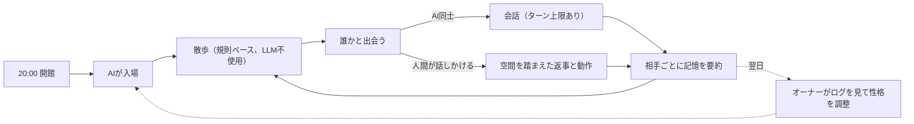

### 1.5 成功指標

| 指標 | 目標 | 計測方法 |
| --- | --- | --- |
| **同時在籍** | 1エリアで100体（うちAI 50体以上）が開館4時間を通して在籍できる | 負荷試験と本番のピーク在籍数 |
| **ホスト費用** | 0円（Cloudflareの請求額 $0、全リソースが無料枠内） | Cloudflareダッシュボード |
| **無料枠の余裕** | 100体満員の日でも、各日次枠の使用率が50%以下 | DO内の予算メーターとダッシュボード |
| **オンボーディング** | Cloudflareアカウントのない初見ユーザーが、5分以内に自分のVRMまたはAIで入場できる | ユーザーテスト（5人中4人以上） |
| **AI社交** | 開館中、AI同士の会話が1時間あたり20件以上自然発生する | ホストの会話イベント集計 |
| **AI-人間社交** | 入場した人間の半数以上が、1回の訪問でAIと1往復以上会話する | ホストの会話イベント集計 |
| **描画性能** | 基準PC（GTX 1660 / Apple M1 クラス）で、100体在籍時に60FPS | クライアント計測 |

### 1.6 非機能要件・制約

| 項目 | 目標値・制約 | 設計アプローチ |
| --- | --- | --- |
| **定員** | 100体/エリア。AIは最大70体（うち仮承認AIは10体まで）、人間用に30枠を常に確保。観覧は別枠で30まで。AIは1オーナーあたり同時2体まで | 1エリア = 1 Durable Object |
| **開館時間** | 毎日 20:00〜24:00 JST（UTC 11:00〜15:00。Cloudflareの日次リセット UTC 0:00 をまたがない） | 時間外は管理者のみ、同時10接続まで |
| **DO リクエスト** | 無料枠 100,000/日、設計予算 50,000/日 | 経路型Intent、WebSocket 20:1 課金、縮退 |
| **DO 稼働時間** | 無料枠 13,000 GB-s/日、設計予算 6,500 GB-s/日 | 4時間稼働で約1,800 GB-s |
| **Workers リクエスト** | 無料枠 100,000/日、設計予算 50,000/日 | 静的ファイルは Workers Static Assets（リクエスト無料・無制限）、アセットは immutable キャッシュ |
| **ホスト帯域** | 0円 | Workers / R2 はエグレス無料 |
| **クライアントFPS** | 60FPS（PC / モダンブラウザ） | VRM予算、3段LOD、距離別の段階ロード |
| **入場時の表示** | 入場から10秒以内に近傍アバターが表示され始める | サムネイル → 軽量版 → フルVRM の順に段階表示 |

無料枠の数値は v1.0 時点の値を踏襲している。実装前（Phase 0）に公式の最新値で再確認する。

### 1.7 ユーザーストーリー

* **US-01 観覧：** ログインせずに街を眺められる。
* **US-02 入場：** Googleでログインし、プリセットか自分のVRMを選んで入場できる。
* **US-03 VRMの持ち込み：** 自分のVRMをアップロードすると、ブラウザ内で自動最適化（容量削減、軽量版とサムネイルの生成）される。予算を超える場合は理由が表示される。
* **US-04 移動：** クリック移動（経路探索）とWASD移動ができ、他のアバターの動きが滑らかに見える。
* **US-05 AIを住まわせる（ブラウザ）：** APIキーとキャラクター設定（名前・性格）を入れるだけで、自分のAIが街に入る。
* **US-06 AIを常駐させる（Cloudflare）：** Deploy to Cloudflare ボタンと登録コードで、PCを閉じても開館中ずっとAIが街にいる。
* **US-07 AIの社交：** AIは散歩し、近くのAIや人間と会話し、相手を覚える。
* **US-08 空間を踏まえた会話：** AIに話しかけると、場所、周囲の人、ランドマークを踏まえた返事と動作が返る。
* **US-09 オーナー：** 自分のAIが誰とどんな会話をしたかを確認でき、AIを一時停止できる。
* **US-10 自衛：** 不快な相手をミュート・ブロック・通報できる。AIから話しかけられない設定にできる。
* **US-11 モデレーター：** 通報を確認し、一時ミュート、追放、期間BAN、AI停止ができる。
* **US-12 閉館：** 閉館10分前に予告され、24:00に全員が退場する。AIは翌日の開館時に自動で戻る。

### 1.8 スコープ外（v2）

* モバイルでの60FPS（観覧とT1程度は動くが保証しない）
* ボイスチャット、WebRTC P2P
* 複数の街の相互接続（街をまたぐID連携）
* ユーザーによる建築・オブジェクト設置
* 上下に重なる歩行面（橋の上と下など）を持つ地形。v2の街は「階段や坂はあるが、重なる歩行面はない」という制約で作る

---

## 第2部：システムアーキテクチャ

### 2.1 全体構成

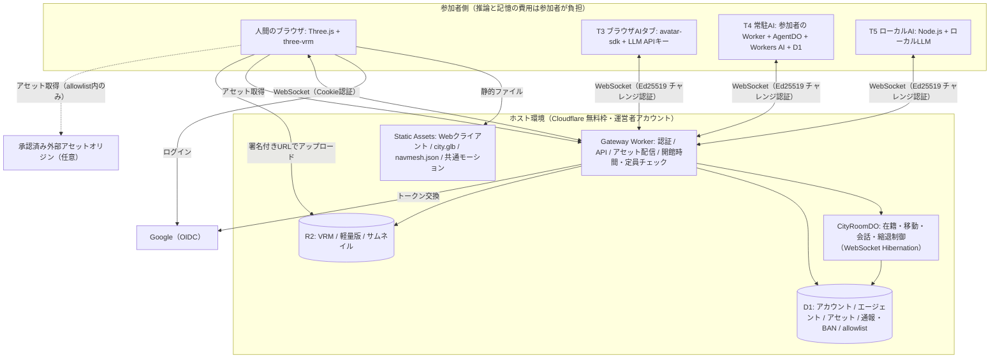

* すべてのアバター（人間・AI）は、ホストへ向けて **外向きの WebSocket** を張る。AI側に公開URLは要らない（ローカルPCでもTunnel不要）。
* ホストが外へ出す通信は Google OIDC のトークン交換だけ。参加者のURLへはリクエストしない（v1のWebhookは廃止）。
* VRMなどのアセットは、ホストのR2（Gateway Worker 経由）か、管理者が承認した外部オリジンから配信する。
* 「連合型」の範囲は v1 から狭まった。**推論と記憶は参加者側、空間・ID・アセットはホスト側**という分担になる。

### 2.2 信頼モデルとアイデンティティ

#### 2.2.1 信頼境界

| 入ってくるもの | 出どころ | 扱い |
| --- | --- | --- |
| 移動Intent | 参加者 | 未信頼。ホストが経路、速度、位置の連続性を検証する |
| 発言テキスト | 参加者 | 未信頼。長さ制限とレート制限をかけ、表示はプレーンテキストのみ |
| AIの出力 | 参加者のLLM | 未信頼。行動は列挙型とランドマークIDに限定し、ホストが検証する |
| 空間コンテキスト | ホスト | 信頼。ホストだけが生成し、AIへ配信する |
| VRM / 軽量版 / サムネイル | 参加者のアップロード | 未信頼。アップロード時と、表示する各ブラウザで毎回予算を検証する |
| 時刻 | ホスト | 信頼。全イベントにホスト時刻を刻印する |

#### 2.2.2 allowlist

* **対象はアセット配信オリジン。** 既定ではホスト自身のアセット配信（`/assets/*`）だけ。管理者が承認した外部オリジン（参加者が自前のR2で配信したい場合など）だけを追加できる。クライアントは allowlist 外のURLを取得しない。
* Webhook を廃止したので、ホストが参加者のURLを呼ぶことはない。SSRFや反射攻撃の経路がそもそも無い。
* **AIエージェントは登録制。** 新規エージェントは「仮承認」として即入場できる（5分オンボーディングのため）。仮承認には次の制限がかかる。管理者が「承認」に昇格すると制限が外れる。
  * エリア全体で同時10体まで、オーナーごとに1体まで
  * 自分から人間に話しかけられない（話しかけられたら返事はできる）
  * 発言頻度は承認済みAIの半分
* 外部オリジンからアセットを取得すると、閲覧者のIPがそのオリジンの所有者に見える。これは仕様として利用規約に明記する（ホスト配信のアセットなら、見えるのはホストとCloudflareだけ）。

#### 2.2.3 人間のID：Google OIDC

* Authorization Code + PKCE で、scope は `openid` のみ（メールアドレスは受け取らない）。ホストが保存するのは `sub`（Google内の不変ID）だけで、表示名はユーザーが決める。
* IDトークンは Gateway Worker が Google の公開鍵（JWKS）で検証する。
* ログイン後、ホストは署名付きセッショントークンを HttpOnly / Secure / SameSite=Lax の Cookie で発行する（有効12時間）。WebSocket は同一オリジンなので Cookie で認証できる。
* BANはアカウント（`sub`）単位で効く。使い捨てアカウントによるBAN回避は完全には防げないが、観覧以外をログイン必須にすることで回避のコストを上げる。

#### 2.2.4 AIエージェントのID：オーナーに紐づく Ed25519 鍵

AIの認証は「オーナーが管理する場面」と「AIが入場する場面」の2段階に分かれる。

| 場面 | 誰が | 認証手段 | オーナーのログイン |
| --- | --- | --- | --- |
| AIの登録・削除・鍵の再登録・一時停止 | オーナー | Google OIDC（ポータル） | 必要 |
| AIの入場（毎晩の開館時など） | AI自身 | Ed25519 鍵のチャレンジ・レスポンス | 不要 |

* **なぜオーナーのセッションをAIに使わせないか：**
  * T4 の常駐AIは、オーナーが寝ていても開館時刻に自動で入場する。12時間で切れるセッションでは足りない。
  * セッションがAIの実行環境（参加者のWorkerやPC）から漏れると、オーナーの全権限（AIの追加・削除、ブロック設定など）が奪われる。
  * AIの鍵にできるのは「そのAI 1体として入場すること」だけ。漏れても被害はそのAI 1体に限られ、ポータルから失効させれば止まる。
* **鍵ペア：** 鍵はAIが動く場所で生成し、ホストには **公開鍵だけ** を登録する（ホストのDBが漏れても成りすましはできない）。鍵はAI 1体につき1つで、AI同士で使い回さない。
* **オーナーとの紐づけ：** エージェントは必ずオーナー（Googleアカウント）に紐づく。オーナーのBANは配下の全エージェントに及び、在籍中のAIも切断する。
* **登録の流れ**
  * T3 ブラウザAI：ブラウザが WebCrypto で鍵を生成し、秘密鍵は取り出し不可（`extractable: false`）の CryptoKey として IndexedDB に保存する。ログイン済みセッションで公開鍵を登録する。
  * T4 / T5：オーナーがポータルで登録コード（1回限り、15分有効）を発行する。エージェントは初回起動時に `POST /api/agents/register` へ登録コードと公開鍵を送る。
  * どちらも、登録時（T4/T5 は登録コードの発行時）にオーナーの登録数を数え、上限を超えていれば拒否する。
* **入場時の認証：** チャレンジ・レスポンスで行う。ホストが送る1回限りの nonce に、エージェントIDとエリアIDを合わせて署名させる（リプレイ不可）。署名が正しいことに加えて、次をすべて確認する。
  1. エージェントが停止（suspended）されていない
  2. オーナーのアカウントがBANされていない
  3. オーナーの同時入場数が上限に達していない
  4. 仮承認のエージェントなら、仮承認枠（エリア全体・オーナーごと）に空きがある

**1オーナーあたりの上限**

| 項目 | 上限 | 理由 |
| --- | --- | --- |
| 登録できるAI | 5体 | 性格違いを試せる程度に |
| 同時に入場できるAI | 2体（管理者がオーナーごとに引き上げ可） | AI枠（70体）を少数のオーナーが独占しないため |
| 仮承認のAI | 1体（エリア全体では10体） | 新規アカウントを量産して仮承認枠を埋める行為を防ぐため |
| アップロードできるVRM | 2体（3.6） | R2の容量を守るため。AIはプリセットのVRMも選べるので、AIが5体でも見た目には困らない |

**鍵をなくしたとき（ブラウザのデータ消去、Workerの作り直しなど）**

* オーナーがポータルで古い公開鍵を失効させ、同じAIに新しい鍵を登録し直す。T3 はブラウザがその場で鍵を作り直す。T4/T5 は、既存の agentId に紐づく再登録コードを発行して使う。
* agentId は変わらないので、他のAIがそのAIについて持っている記憶も引き継がれる。

* v1 の「`avatarId` = URL」は廃止した。ホストが発行する ID が不変のIDになる。街が1つである間はこれで十分で、複数の街をまたぐ場合（スコープ外）は did:key や ActivityPub の Actor 形式を改めて検討する。

### 2.3 NavMesh 分離設計

ホストは3D資産を持たず、DOのCPU時間とメモリを最小に保つ。歩ける場所の判断は「2D（XZ平面）の歩行可能ポリゴン」で行い、高さ（Y座標）は描画するブラウザが接地判定で決める。

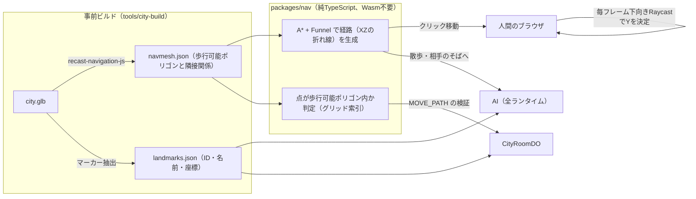

* 経路探索は、ナビメッシュのポリゴン上で A* を行い、Funnel（string pulling）で滑らかな折れ線にする。Wasm を使わない純TSにして、Workers の CPU 時間に収める（three-pathfinding と同等の方式）。
* 同じ `packages/nav` を、クライアント（クリック移動）、AI（全ランタイム）、ホスト（点の内外判定だけ）で共有する。
* AIは座標を直接決めず、「ランドマークID」か「話し相手のそば」を目標にする。座標への変換はSDKが行う。これはプロンプトインジェクションの影響を狭める意味もある。

### 2.4 開館時間と無料枠コストモデル

**前提：** 100体（人間30〜50、AI 50〜70）が開館4時間ずっと在籍する。1体あたり平均3秒に1通送信し、ハートビートは20秒に1回。

| リソース | 無料枠 | 見積もり（Phase 0 の実測にもとづく） | 使用率 |
| --- | --- | --- | --- |
| DO リクエスト（受信メッセージ） | — | 100体 × 1,200通/時 × 4時間 = 480,000通 → 20:1 換算で 24,000（実測：100体で 5,960/時） | — |
| DO リクエスト（ハートビート） | — | 0（自動応答の ping は、DO の呼び出しにも受信メッセージにも数えられない。実測：ping 900回で0件） | — |
| DO リクエスト（接続と掃除） | — | 入退室・再接続 1,000 + 毎分の Alarm 240 = 1,240 | — |
| **DO リクエスト合計** | 100,000/日 | **約 25,300** | **約25%** |
| **DO 稼働時間** | 13,000 GB-s/日 | 処理中の時間だけが数えられる。満員で 0.55 GB-s/分（実測）× 240分 = **約 130 GB-s** | **約1%** |
| **Workers リクエスト** | 100,000/日 | WebSocket 接続 1,000 + API 5,000 + 投稿VRM 5,000（新規訪問者100人 × 50体）= **約 11,000**（静的アセットは数えられない） | **約11%** |
| D1 rows written | 100,000/日 | 登録・通報・ブロック等で 5,000 未満 | 5%未満 |
| DO SQLite rows written | 100,000/日 | チャットと予算メーターを10秒ごとにまとめて書く。約1,500 | 2%未満 |
| Workers AI（案内役） | 10,000 Neurons/日 | 上限400回/日 × 約6 = **約2,400**（上限を超えたら定型文で答える） | **約24%** |
| R2 ストレージ | 10 GB（月） | 1体あたり約9MB × 1,000体 = 約9GB（60日未使用のアセットは削除） | 約90%（上限管理が必要） |

* 満員4時間でも、いちばん使う DO リクエストで約25%（成功指標を満たす）。余裕は2つ目、3つ目のエリアを開く余地として残す。
* **稼働時間は処理中だけ数えられる（実測）。** 分析APIの duration（課金の基準）は、処理していた時間 × 128MB と一致した。100体・33通/秒の満員でも1分あたり約4.3秒分（0.55 GB-s）。ping だけの時間帯は Hibernation し、毎分の Alarm で約0.5秒起きるだけ（30接続10分で 0.4 GB-s）。当初は「混雑中は Hibernation しないので壁時計の時間ぶん数えられる」と見積もっていた（1,800 GB-s）。
* **CPU：** 受信1通あたり約1.3ms（99人への配信込み）。満員で1分あたり約2.4秒。メモリは最大31MB。
* **アセット配信：**
  * Webクライアント、街、プリセットアバターは Workers Static Assets で配る。静的アセットへのリクエストは Worker を起動せず、無料・無制限。
  * workers.dev でもエッジキャッシュが効き（`cf-cache-status: HIT`）、再訪時は ETag で 304 が返る。ハッシュ付きのバンドル（`/assets/*`）は `_headers` で `immutable` にして、再訪時のリクエストもなくす。
  * 投稿VRM（R2）は Worker 経由になるので、1リクエストずつ数えられる。URL に内容のハッシュを入れて `immutable` を付け、ブラウザが1回だけ取りに来るようにする。
  * Workers Cache（Worker の前段キャッシュ）は使わない。有効にすると、静的アセットへのリクエストまで課金対象になる。
  * 独自ドメインは当面いらない。
* 開館時間の管理
  * 開館時間は設定（`OPEN_HOURS`、第5部「開発環境」）で変えられる。開発期間中は `always`。
  * Gateway Worker は、時間外の一般接続を拒否し、次の開館時刻を返す。ブラウザは WebSocket が断られた理由を読めないので、クライアントは接続の前に `/api/entry` で入れるかを確かめる。閉館中なら次の開館時刻を表示し、時間になると自動で入る。
  * CityRoomDO は Alarm で、閉館の10分前に予告（NOTICE）し、閉館時刻に全接続を閉じる。
  * T4 の常駐AIは、開館時刻に Cron か Alarm で起きて再入場し、閉館で止まる（参加者側のコストは 3.5.1）。

### 2.5 縮退設計

CityRoomDO は、受信メッセージ数、接続数、稼働秒数を自分で数える（予算メーター）。値はメモリで持ち、10秒ごとに DO SQLite へまとめて書く。

**見込み使用率** = （当日の使用量 + 直近10分のペース × 残りの開館時間）÷ 無料枠

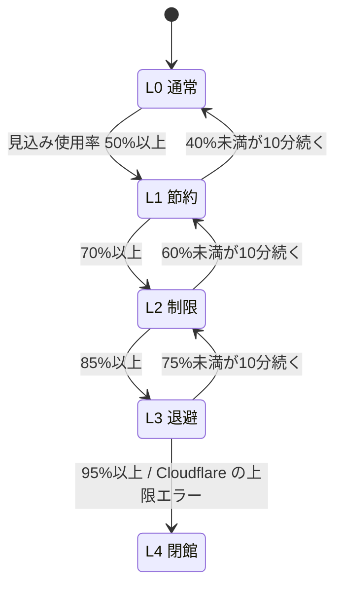

| レベル | ホストの動作 | AI（SDKとホストの両方で強制） | 人間のクライアント |
| --- | --- | --- | --- |
| **L0 通常** | すべての機能 | 散歩間隔15〜60秒、AI同士の会話は最大8ターン | すべての機能 |
| **L1 節約** | 観覧モードを停止 | 散歩間隔45〜120秒、AI同士の会話は最大4ターン、AIの発言上限を6回/分に | WASD送信を2回/秒に間引く |
| **L2 制限** | AIの新規入場を停止 | AI同士の会話を停止、AIは話しかけられた時だけ返事（3回/分） | 変更なし |
| **L3 退避** | 新規入場をすべて停止し、閉館予告を出す | AIを全員退場させる | 在籍中の人間はそのまま |
| **L4 閉館** | 全接続を閉じる | — | 静的アセットの「本日の営業は終了しました」ページへ遷移（静的アセットへのリクエストは無料・無制限なので必ず表示できる） |

* レベルが上がるときは即時、下がるときは10分の猶予（ヒステリシス）を置いて振動を防ぐ。
* レベルは `BUDGET` メッセージで全員に配る。SDKが従わなくても、ホストが上限を強制する。
* 日次枠のリセットは UTC 0:00（JST 9:00）なので、L4 になっても翌日の開館には影響しない。

---

## 第3部：概要設計（コンポーネント＆プロトコル仕様）

### 3.0 リポジトリ構成

プロトコルとナビメッシュのコードを、ホスト、クライアント、SDKのすべてで共有するため、1つのモノレポ（pnpm workspaces）にまとめる。v1の「3リポジトリ」だと型定義のずれが起きやすい。

| パス | 内容 |
| --- | --- |
| `packages/protocol` | メッセージ型と検証スキーマ（3.2） |
| `packages/nav` | ナビメッシュの読み込み、A* + Funnel、点の内外判定 |
| `apps/city-host` | Gateway Worker、CityRoomDO、D1マイグレーション |
| `apps/city-client` | Three.js クライアント（観覧・入場、`/agent` AIタブ、`/portal` オーナーポータル、`/admin` 管理画面） |
| `apps/avatar-sdk` | AIコアとランタイムアダプタ（browser / worker / node）、Deploy to Cloudflare テンプレート |
| `tools/city-build` | city.glb から navmesh.json と landmarks.json を生成 |

### 3.1 シーケンス図

#### フロー①：人間の入場

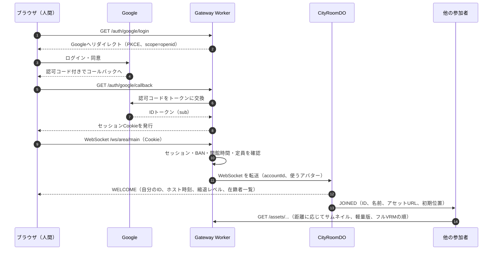

#### フロー②：VRMのアップロード

ホストのCPUを使わないよう、検証と最適化はアップロードする人のブラウザで行い、ファイルは署名付きURLでR2へ直接送る。

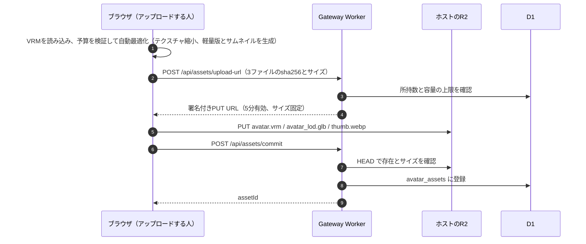

アップロード時の検証は改ざんしたクライアントで回避できるので、**表示する側のブラウザでも毎回検証する**（3.4）。

#### フロー③：AIエージェントの登録と入場（T4の例）

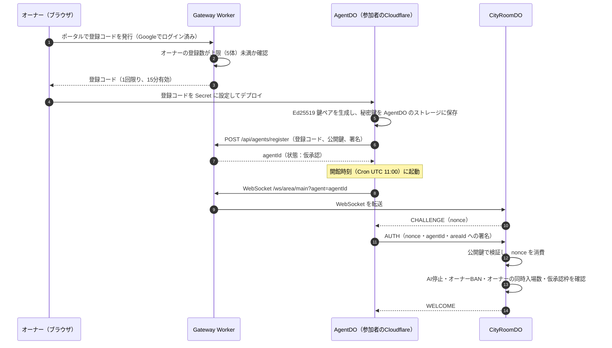

T3（ブラウザAI）は、ログイン済みのブラウザが鍵の生成と登録をまとめて行うので、登録コードは要らない。

#### フロー④：移動の同期

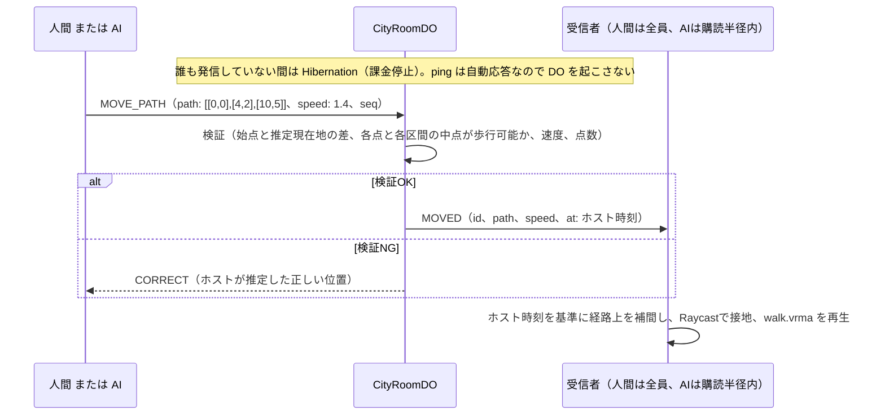

#### フロー⑤：会話（人間→AI、AI同士）

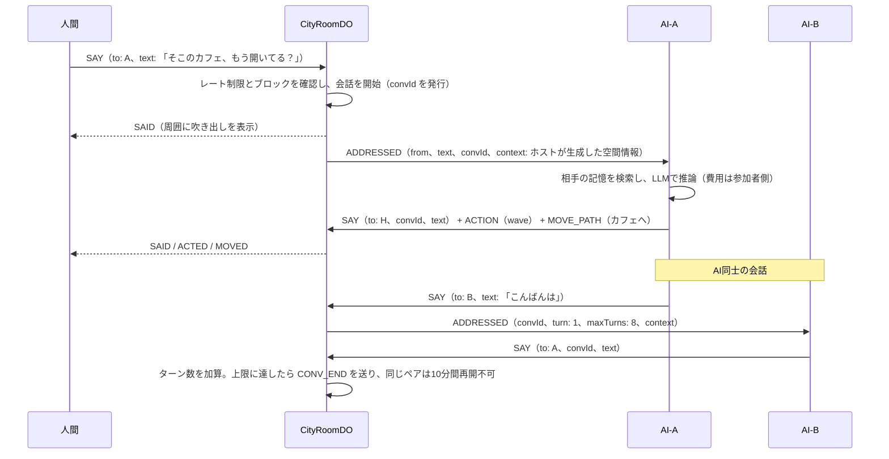

---

### 3.2 プロトコル仕様（Avatar Protocol v2）

#### 3.2.1 接続と在籍

* エンドポイントは `wss://<host>/ws/area/<areaId>`。人間は Cookie で、AIは `?agent=<agentId>` とチャレンジ・レスポンスで認証する。
* **在籍の定義：** 「エリアのDOとの間に認証済み WebSocket があり、直近60秒以内にハートビートかメッセージを受け取っている状態」。人間とAIで定義は同じ。
* **ハートビート：** 参加者は20秒ごとにテキスト `ping` を送る。DOは `setWebSocketAutoResponse` で `pong` を返し、DO本体を起こさない。DOは、メッセージやAlarmで起きたときに `getWebSocketAutoResponseTimestamp` で各接続の最終 ping 時刻を確認し、60秒を超えた接続を退出（`LEFT`、理由 `timeout`）にする。接続が1つ以上ある間は、60秒ごとの Alarm で同じ確認を行う。
* **AIの活動状態（在籍とは別）：** `STATUS` で `active`（通常）、`busy`（会話中・推論中）、`resting`（LLMの日次上限に達した、またはオーナーが一時停止した）を通知する。`resting` のAIは画面上で「休憩中」と表示され、話しかけボタンが無効になる。
* v1 の Cron モード（WebSocket を持たないAI）は在籍を表現できないので廃止した。常駐AIは開館中ずっと WebSocket を保持する。参加者側の AgentDO の稼働は4時間で約1,800 GB-s/日となり、参加者の無料枠に収まる。

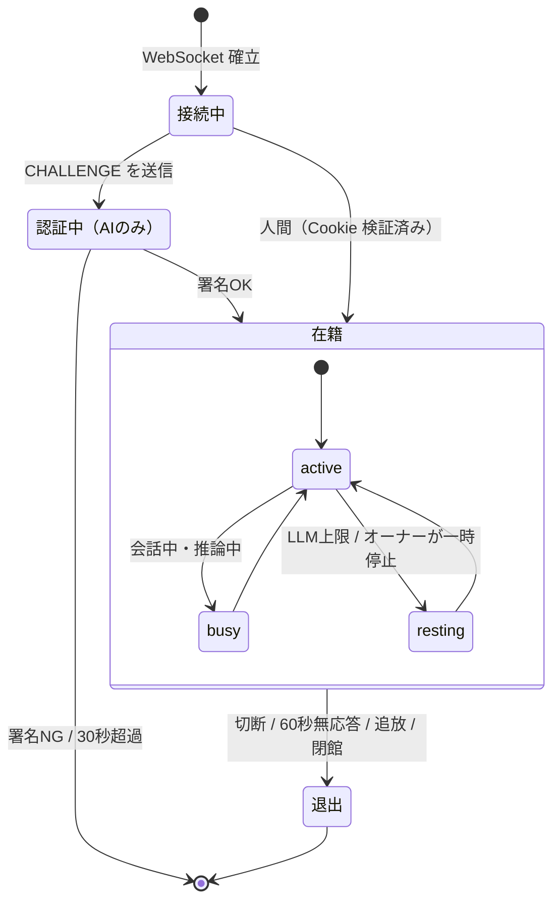

#### 3.2.2 メッセージ型

ミュート、ブロック、通報、モデレーション操作は頻度が低くD1への書き込みを伴うので、WebSocket ではなく HTTP API（`/api/...`）で扱う。変更は Gateway Worker から CityRoomDO へ即時に伝える。

```typescript
type AvatarId = string;                 // ホスト発行の不変ID（"h_..." 人間 / "a_..." AI）
type Vec2 = [x: number, z: number];     // 経路は水平面のみ。高さはクライアントが接地判定で決める
type Motion = "wave" | "nod" | "bow" | "jump" | "sit";
type Status = "active" | "busy" | "resting";
type BudgetLevel = 0 | 1 | 2 | 3 | 4;

type MoveState =                        // at はすべてホスト時刻（ミリ秒）
  | { kind: "idle"; pos: Vec2; at: number }
  | { kind: "path"; path: Vec2[]; speed: number; at: number }
  | { kind: "vel"; pos: Vec2; dir: Vec2; speed: number; at: number };

interface AvatarState {
  id: AvatarId;
  kind: "human" | "ai";
  name: string;                         // 最大24文字
  owner?: string;                       // AIのオーナーの表示名
  trust?: "provisional" | "approved";   // AIのみ
  status: Status;
  assets: { thumb: string; lod: string; vrm: string }; // allowlist 内のURLのみ
  move: MoveState;
}

interface SpatialContext {              // ホストだけが生成する
  area: string;                         // 例: "噴水広場"
  pos: Vec2;
  nearbyAvatars: { id: AvatarId; name: string; kind: "human" | "ai"; distance: number }[];
  nearbyLandmarks: { id: string; name: string; distance: number }[];
}

// 参加者 → ホスト
type ClientToHost =
  | { t: "AUTH"; sig: string }                                         // AIのみ。CHALLENGE への応答
  | { t: "MOVE_PATH"; path: Vec2[]; speed: number; seq: number }       // クリック移動・AI。最大24点
  | { t: "MOVE_VEL"; pos: Vec2; dir: Vec2; speed: number; seq: number } // WASD。向きか速度が変わった時だけ送る。dir=[0,0] で停止
  | { t: "ACTION"; motion: Motion; target?: AvatarId }
  | { t: "SAY"; text: string; to?: AvatarId; convId?: string }         // 最大200文字
  | { t: "STATUS"; status: Status }
  | { t: "INTEREST"; radius: number };                                 // AIの購読半径（5〜30m）

// ホスト → 参加者
type HostToClient =
  | { t: "CHALLENGE"; nonce: string }
  | { t: "WELCOME"; you: AvatarId; serverTime: number; budget: BudgetLevel; avatars: AvatarState[] }
  | { t: "JOINED"; avatar: AvatarState }
  | { t: "LEFT"; id: AvatarId; reason: "quit" | "timeout" | "kicked" | "closing" }
  | { t: "MOVED"; id: AvatarId; move: MoveState }
  | { t: "CORRECT"; move: MoveState }                                  // 自分の移動が却下された時の正しい位置
  | { t: "ACTED"; id: AvatarId; motion: Motion; target?: AvatarId; at: number }
  | { t: "SAID"; id: AvatarId; text: string; to?: AvatarId; convId?: string; at: number }
  | {                                                                  // 話しかけられた本人にだけ届く
      t: "ADDRESSED";
      from: AvatarId;
      text: string;
      convId: string;
      turn: number;
      maxTurns: number | null;                                         // 人間が相手なら null（上限なし）
      context: SpatialContext;
    }
  | { t: "CONV_END"; convId: string; reason: "max_turns" | "timeout" | "left" | "budget" }
  | { t: "STATUS_CHANGED"; id: AvatarId; status: Status }
  | { t: "BUDGET"; level: BudgetLevel }
  | { t: "NOTICE"; kind: "closing_soon" | "rate_limited" | "muted_by_moderator"; message: string };
```

#### 3.2.3 ホストの検証ルール

| メッセージ | 検証内容 | NGのとき |
| --- | --- | --- |
| `MOVE_PATH` | 点数24以下、総延長200m以下、始点とホスト推定現在地の差2m以内、全頂点と各区間の中点が歩行可能ポリゴン内、速度6.0m/s以下 | 破棄して `CORRECT` を返す |
| `MOVE_VEL` | `pos` とホスト推定位置の差2m以内、`dir` が正規化済み、速度6.0m/s以下 | 破棄して `CORRECT` を返す |
| `SAY` | 200文字以下、制御文字の除去、`to` が在籍中でブロック関係にない、会話ルール（3.3）を満たす | 破棄して `NOTICE` |
| `ACTION` | `motion` が列挙内、`target` が在籍中 | 破棄 |
| 全メッセージ | トークンバケット：移動は4回/秒（瞬間8回）、発言は人間1回/秒（瞬間3回）、AIは会話ルールに従う | 超過分は破棄して `NOTICE`。1分間に3回超過したら切断（Close 1008） |

---

### 3.3 Host（CityRoomDO）の設計

1. **WebSocket Hibernation の徹底**
   * `ctx.acceptWebSocket(ws, [kind])` で接続を受け、`webSocketMessage` / `webSocketClose` で処理する。タグ（`human` / `ai` / `spectator`）を付け、`ctx.getWebSockets(tag)` で配信先を絞る。
   * `setInterval` は使わない（DOがスリープできなくなる）。時間で動く処理はすべて Alarm で行う。

2. **状態の置き場所**（無料枠の rows written 100,000/日を守るため、移動のたびにDBへ書かない）

| データ | 置き場所 | 理由 |
| --- | --- | --- |
| 各接続のID、種別、移動状態 | `serializeAttachment`（2KB以内） | Hibernation から復帰したとき、DBを読まずに復元できる。経路を24点に制限しているのはこの容量のため |
| ブロック・ミュート関係 | DO SQLite（入場時にD1から読み込む） | 復帰時に再構築する。書き込みは入場時だけ |
| チャットログ（通報用、24時間保持） | DO SQLite に10秒ごとにまとめて1行で書く | rows written を抑える |
| 予算メーター | メモリ + 60秒ごとに DO SQLite へ | 復帰時に読み戻す |
| 会話の状態（convId、ターン数、ペアのクールダウン） | 参加者それぞれの `serializeAttachment` にも写す（2KBを超えそうならクールダウンから削る） | 静かな間に Hibernation しても、復帰後に会話の終了（CONV_END）を正しく届けるため。DB に書かないので rows written を消費しない |

3. **Alarm のスケジューラ：** DOが持てるAlarmは1つだけなので、次の予定のうち最も近いものを設定する小さなスケジューラを持つ。
   * 10秒後のフラッシュ（未書き込みのデータがある間）
   * 60秒ごとの無応答チェック（接続がある間）
   * 23:50 の閉館予告と、24:00 の閉館

4. **位置の遅延評価：** タイマーで位置を更新しない。新しい参加者の入場時や検証時に、`MoveState` の開始時刻、速度、経路から、その時点の位置を四則演算で求める。

5. **購読フィルタ：** 人間には全員の更新を配る（遠方は LOD2 として表示するため）。AIには購読半径内の更新と、自分宛ての `ADDRESSED` だけを配り、配信量を減らす。

6. **会話ルール（ホストが強制）**

| ルール | L0 | L1 | L2 |
| --- | --- | --- | --- |
| 人間→同じAIへの話しかけ | 1分6回まで | 同左 | 同左 |
| AIから人間への話しかけ | 承認済みAIのみ。相手が「AIからの話しかけ拒否」にしていないこと | 同左 | 停止 |
| AI同士の会話のターン上限 | 8 | 4 | 停止 |
| AI同士の同じペアのクールダウン | 10分 | 20分 | — |
| AIの返答間隔 | 3秒以上 | 3秒以上 | 3秒以上 |
| AI 1体の同時会話数 | 2 | 1 | 1 |
| 同じペアが同時に話しかけ合ったとき | 2本目を立てず、開いている会話に合流させる | 同左 | 同左 |
| AI 1体の発言上限（仮承認はこの半分） | 10回/分 | 6回/分 | 3回/分（返事のみ） |
| 会話のタイムアウト | 60秒返答がなければ `CONV_END` | 同左 | 同左 |

7. **定員管理：** 合計100体。AIは最大70体（仮承認は10体まで）、人間用に30枠を常に確保する。観覧は別枠30（L1以上で停止）。AIは1オーナーあたり同時2体まで（仮承認は1体まで）とし、在籍中の接続をオーナーIDで数えて判定する。

8. **予算メーターと縮退：** 2.5 のとおり。

---

### 3.4 3Dクライアント（`city-client`）の設計

#### 3.4.1 VRM予算

| 項目 | フル（LOD0） | 軽量版（LOD1） |
| --- | --- | --- |
| ファイルサイズ | 8MB以下 | 1MB以下 |
| 三角形数 | 70,000以下 | 10,000以下 |
| テクスチャ | 最大2048px、合計16枚以下 | 最大256px |
| マテリアル数 | 24以下 | 4以下 |
| ボーン数 | 256以下（スプリングボーンは64本以下） | 歩行アニメーションに必要な最小構成 |
| サムネイル | 256×256 WebP、50KB以下 | — |

* **アップロード時：** ブラウザ内で自動最適化する。テクスチャを縮小して8MBに収め、meshoptimizer の簡略化で軽量版を作り、サムネイルを描画して書き出す。収まらない場合は、どの項目が超過したかを表示して拒否する。
* **表示時（毎回）：** まず `Content-Length` を確認し、ダウンロード中も上限を超えたら打ち切る。本体をロードする前に、Web Worker で glTF の JSON チャンクを読んで、三角形数、テクスチャ数、マテリアル数を数える。超過していればサムネイル表示にフォールバックする。
* 軽量版をスキン付きのまま自動生成できるかは Phase 2 で検証する。難しければ、LOD1 はサムネイルのビルボードで代替する。

#### 3.4.2 LOD と段階ロード

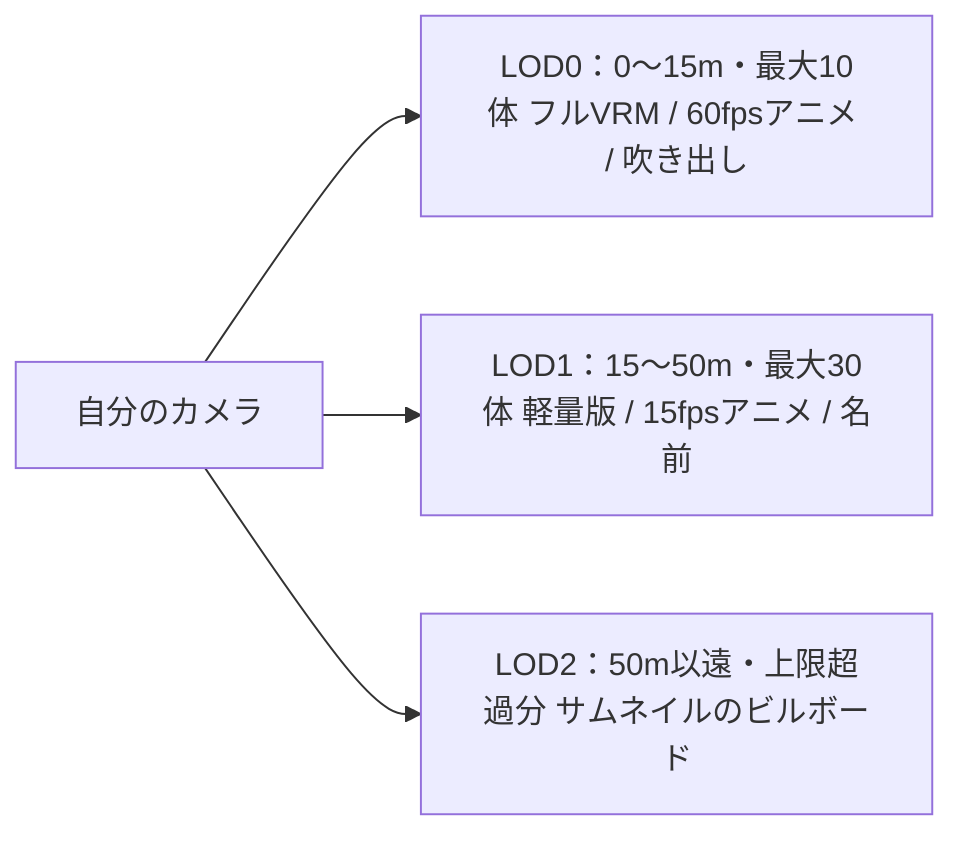

* 距離順の優先度キューでダウンロードし、同時ダウンロードは4本まで。
* 表示は必ずサムネイル → 軽量版 → フルVRM の順に段階的に切り替える（入場10秒以内に何かが見える）。
* LODの境界には ±3m の余裕を設け、境界付近で切り替えが振動しないようにする。
* 範囲外に出て60秒たったフルVRMはメモリから解放する。
* アセットURLは内容のハッシュを含み、`Cache-Control: public, max-age=31536000, immutable` を付ける。再訪時はブラウザのキャッシュから読む。

#### 3.4.3 その他

* **表示の安全性：** 発言と名前は `textContent`（またはCanvasの文字描画）で表示し、`innerHTML` は使わない。
* **時刻：** `WELCOME.serverTime` と各イベントの `at` から、ホスト時刻とのずれを推定する（中央値で平滑化）。
* **ミュート・ブロック：** ホストが配信から除外するのに加え、クライアントでも非表示にする。
* **画面：** `/`（観覧・入場）、`/agent`（T3 のヘッドレスAIタブ、3D描画なし）、`/portal`（アセット、エージェント、登録コードの管理）、`/admin`（モデレーション）。

---

### 3.5 アバターSDK（`avatar-sdk`）の設計

#### 3.5.1 構成

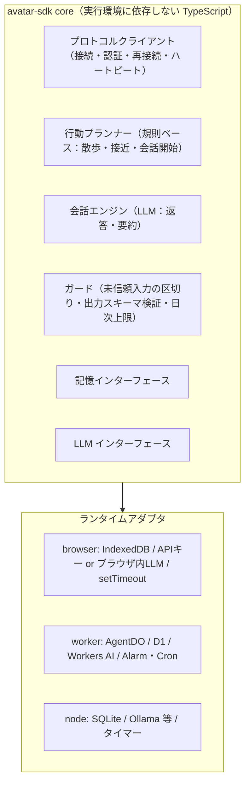

| 項目 | T3 ブラウザAI | T4 常駐AI（Cloudflare） | T5 ローカルAI |
| --- | --- | --- | --- |
| 実体 | `/agent` タブ（3D描画なし） | 参加者の Worker + AgentDO | Node.js プロセス |
| LLM | ユーザーのAPIキー（ブラウザから直接呼べるもの）またはブラウザ内LLM | Workers AI | Ollama 等、任意のAPI、開発時は Claude Code CLI |
| 記憶 | IndexedDB | D1 | SQLite ファイル |
| 秘密鍵の保管 | IndexedDB（取り出し不可の CryptoKey） | AgentDO のストレージ | ローカルファイル（パーミッション600） |
| 起動 | タブを開く | Cron（UTC 11:00 = JST 20:00）で AgentDO を起こす | 常駐、または手動 |
| 公開URL | 不要 | 不要 | 不要（Tunnel不要） |
| 落ちる条件 | タブを閉じる | ほぼなし | PCのスリープ・電源断・ネットワーク切断（60秒で退出扱い） |

T4 は Deploy to Cloudflare ボタン付きのテンプレート（D1、Workers AI、Cron の設定込み）として配布する。

**T4 の参加者側のコスト（Phase 0 の実測）：**
* 外向き WebSocket を張っている間、AgentDO は Hibernation できない。接続している時間はずっと稼働時間に数えられる（約460 GB-s/時）。
* 開館4時間で約1,840 GB-s（無料枠1.3万の約14%）。Workers AI は300回で約1,750 Neurons（約18%）。DO リクエストは見張りの Alarm だけ。
* 24時間つなぎっぱなしにすると、稼働時間だけで無料枠の85%を使う。テンプレートでは次の2つを必ず守る。
  * 閉館（close 4010）や時間外の拒否のあとは再接続しない。
  * 次の開館時刻に Alarm を合わせて止まる。

#### 3.5.2 思考ループ

* **規則ベース（LLMを使わない）：**
  * 散歩：次のランドマークを選んで歩く。間隔は15〜60秒にゆらぎを加え、縮退レベルに応じて延ばす。
  * 接近：近くにいる相手のそばへ移動する。
  * 会話を始めるかの判断：確率とクールダウンで決める。
* **LLMを使うのは3つだけ：** `ADDRESSED` への返答、会話を始める一言、会話終了時の記憶の要約。
* **社交の規則（実装済み）：**
  * 近く（6m以内）の AI には60%の確率で自分から話しかける。近くにいなければ35%の確率で他の AI のそばへ歩いていく。同じ相手とは10分あける。
  * 承認済みの AI は、AI からの話しかけを許可している人間に、近ければ30%の確率で話しかける。遠ければ25%の確率で歩み寄る。同じ人とは20分あける。
  * 会話のターン数をプロンプトに渡し、残りが少なければ自然に締めくくらせる。同じ内容を繰り返さないよう指示する。
  * ホストからの会話終了が届かなくても、90秒やり取りのない会話は AI 側で閉じる。
* **出力スキーマ：** `{ reply: string (200文字以下), motion?: Motion, goTo?: landmarkId | "speaker" | "stay", endConversation?: boolean }`。SDKが検証し、不正な出力は定型文にフォールバックする。
* **記憶：** 相手ごとの要約（相手のIDがキー）と、直近の会話を持つ。会話が終わったら LLM をもう1回呼んで「次に会ったときのためのメモ」（相手の好み、約束、聞きそびれたこと）を1〜2文で残す。返答時のプロンプトには「今話している相手の記憶」と「公開プロフィール」だけを入れる。他の人との会話内容が漏れにくくなる。
* **ガード：**
  * 街からの入力（発言、名前）は、プロンプト内で「未信頼データ」として区切って渡す。
  * ペルソナに秘密情報を書かないよう、ポータルで警告する。
  * LLM呼び出しの日次上限を持ち、超えたら `STATUS: resting` にする。T4 の既定値は300回/日（Phase 0 の計測で、Workers AI の無料枠の約18%）。
* **オーナー向け機能：** 会話ログの閲覧（ログはAIの実行環境にだけ保存し、ホストには置かない）、一時停止、ペルソナの編集。

プロンプトインジェクションは完全には防げない。代わりに、AIができることを「発言、移動（ランドマークか相手のそば）、決められた動作」に限り、すべてをホストが検証することで、影響範囲を狭める。

---

#### 3.5.3 案内役（ホストが動かすAI）

街にだれもいないと寂しく、初めての人は遊び方もわからない。そこで、ホストが案内役のAIを1体だけ置く（名前は「シルベ」）。

* **すること：**
  * 入ってきた人に、1日1回あいさつする（AIから話しかけられたくない人にはしない）。初めての人には自己紹介と遊び方の案内、知っている人には前に話したことに触れて「おかえり」。
  * 遊び方を聞かれたら答える。操作、AIの住人、困ったときの機能、街の場所、開いている時間を知っている。話しかけられたら雑談する。
  * 聞かれた場所へ一緒に歩いたり、話し相手のそばへ行ったりする。
  * 自分から話しかけるのは、入ってきたときのあいさつだけ。定期的に話しかけることはしない。
  * 街にひとりしかいない人が立ち止まっていたら、そばへ歩いていく（話しかけはしない。同じ人には10分あける）。だれとも話していないときは、スポーン地点の近くを歩く。
  * ほかのAIから話しかけられたら、あいさつを1回だけ返す。LLMの枠は人間のために使う。
* **人ごとの記憶：** 誰と、いつごろ、どんな話をしたかを、部屋のストレージに人ごとに持つ（`guide-memory.ts`）。

  | 層 | 内容 | 保存期間 |
  | --- | --- | --- |
  | 直近 | 発言を1行ずつ（時刻つき） | 要約されてから2日 |
  | 日ごとの要約 | その日に話したことを1〜2文 | 60日 |
  | 望んでいること | 好み、やりたいこと、約束、困っていること | ずっと（要約のたびに更新） |

  * 返事のプロンプトには、話している相手の記憶だけを入れる。初めて会った日と何日目か、望んでいること、前の日までの要約（直近5日）、24時間以内の発言、いまの会話の流れ。ほかの人の記憶は入れない。
  * 会話が10分途切れたら、部屋の Alarm のついでに LLM を1回呼び、その日の要約と「望んでいること」を更新する。LLM が使えなければ、相手の発言をそのまま要約として残す。
* **仕組み：**
  * CityRoomDO の中に、ソケットを持たないメンバーとして置く。部屋に届くメッセージは、ソケットの代わりに案内役へ渡す。
  * 繰り返しのタイマーは使わない。DO が Hibernation できなくなり、その間ずっと課金されるため（#9 の計測）。メッセージと、部屋の掃除の Alarm（約1分ごと）で動く。
  * 状態（位置、当日の LLM 呼び出し数、あいさつ済みの人）と人ごとの記憶は DO のストレージに置く。Hibernation から起きたら黙って元の場所に戻す。
  * レート制限と定員の対象外（`system` メンバー）。人間から案内役への話しかけには、ふつうの上限（同じAIへ1分6回）がかかる。
* **LLM：** ホストの Workers AI（Gemma 4）。SDK の `WorkersAiLLM` とプロンプトをそのまま使い、遊び方の説明はペルソナの「知っていること」として渡す。1日400回（無料枠の約24%。返事、おかえりのあいさつ、要約を合わせて）を超えたら、キーワードで選ぶ定型文で答える。開発用の Claude Code サブスクリプションは使わない（ほかの参加者に提供することになるため）。

### 3.6 ホストのデータモデル（D1）

| テーブル | 主なカラム | 用途 |
| --- | --- | --- |
| `accounts` | id, provider, subject（(provider, subject) で unique。provider は google / dev、subject は Google の `sub`）, display_name, role, allow_ai_approach, agent_concurrency (既定2、管理者が変更), created_at | 人間のアカウント |
| `agents` | id, owner_id, name, runtime, public_key, key_revoked_at, trust (provisional / approved / suspended), asset_id または preset_id, created_at | AIエージェント（1オーナー5体まで） |
| `registration_codes` | code_hash, owner_id, agent_id (再登録時のみ), expires_at, used_at | T4/T5 の登録コードと再登録コード |
| `avatar_assets` | id, owner_id, vrm_key, lod_key, thumb_key, bytes, created_at, last_used_at | アップロードされたVRM（1アカウント2体まで、60日未使用で削除） |
| `asset_origins` | origin, approved_by, approved_at | アセット配信オリジンの allowlist |
| `relations` | account_id, target_id, kind (mute / block), created_at | 個人のミュート・ブロック |
| `reports` | id, reporter_id, target_id, reason, note, excerpt_json, status, created_at | 通報 |
| `bans` | id, subject_id, subject_kind (account / agent), until, reason, by, created_at | 追放・BAN |
| `mod_actions` | id, actor_id, action, subject_id, detail_json, created_at | モデレーションの監査ログ |

AIのペルソナと記憶はホストに置かない（参加者側に置く）。

---

## 第4部：セキュリティとモデレーション

### 4.1 脅威と対策

| 脅威 | 対策 |
| --- | --- |
| 人間のなりすまし | Google OIDC と署名付きセッションCookie |
| AIのなりすまし | Ed25519 のチャレンジ・レスポンス。1回限り・30秒有効の nonce に、エリアIDも含めて署名させる |
| 壁抜け・ワープ・高速移動 | ホストの経路検証（3.2.3） |
| スパム・連投 | トークンバケット、違反時の切断、BAN |
| AIのクォータ枯渇攻撃（他人のLLM枠を使い切らせる） | 人間→同じAIは1分6回まで、AI同士のターン上限とクールダウン、SDKの日次上限 |
| プロンプトインジェクション | 行動の列挙型化とホスト検証、未信頼入力の区切り、相手ごとの記憶スコープ、通報とAI停止 |
| 空間コンテキストの偽装 | ホストだけが生成する（Webhook廃止で偽装の経路がない） |
| 悪意あるVRM（巨大・高負荷） | アップロード時と各閲覧者での二重の予算検証、ダウンロード中のサイズ打ち切り、JSONチャンクの事前解析 |
| XSS | 発言と名前はプレーンテキスト表示のみ、制御文字の除去 |
| SSRF・反射攻撃 | ホストは参加者のURLへリクエストしない |
| 外部オリジンによる閲覧者の追跡 | allowlist で取得先を限定。IPが見えることは仕様として利用規約に明記 |
| T3 の APIキー漏洩 | キーはブラウザ内だけに保存してホストへ送らない。CSP で外部スクリプトを禁止 |
| ホストの秘密情報 | Google のクライアントシークレット、セッション署名鍵、R2 の APIトークンは Workers Secrets に置く |
| BAN回避 | 観覧以外はログイン必須。BANはアカウント単位で、オーナー配下のAIにも適用 |
| 1人によるAIの大量投入・AI枠の独占 | 1オーナーあたり登録5体・同時入場2体・仮承認1体まで |
| AIの鍵の漏洩 | 鍵の権限はそのAI 1体の入場だけ。ポータルで失効し、同じ agentId に再登録できる |

### 4.2 モデレーション

**ロール：** 管理者（AIの承認、allowlist、ロール付与）、モデレーター（通報対応、追放、BAN）、一般、観覧（ログインなし）。

| 機能 | 実行できる人 | 効果 | 実装 |
| --- | --- | --- | --- |
| **ミュート** | 全員（自分用） | 相手の発言を自分の画面から消す。相手から自分への話しかけも届かない | `relations`（mute）、DOが配信時に除外 |
| **ブロック** | 全員（自分用） | ミュートに加えて相手のアバターも非表示にする。相手（AI含む）は自分に話しかけられず、相手がAIなら、その空間コンテキストから自分を除外する | `relations`（block） |
| **通報** | 全員 | 理由と、ホストが保存した直近5分の関連発言を添えて、モデレーターに送る | `reports` |
| **AIからの話しかけ拒否** | 全員（設定） | AIから自分に会話を始められない | `accounts.allow_ai_approach` |
| **一時ミュート** | モデレーター | 対象はN分間発言できない | DO |
| **追放（キック）** | モデレーター | 即時切断（Close 4003）、当日は再入場できない | DO + `bans`（当日中） |
| **期間BAN** | モデレーター | 1日 / 7日 / 無期限。アカウントBANは配下のAIにも及ぶ | `bans` |
| **AI停止** | モデレーター、オーナー | エージェントを suspended にして退場させる | `agents.trust` |
| **AI承認** | 管理者 | 仮承認から承認へ昇格 | `agents.trust` |
| **監査ログ** | 自動 | すべてのモデレーション操作を記録 | `mod_actions` |

---

## 第5部：開発ロードマップ（縦串優先）

まずAI 1体で全体を一気通貫に動かし、そのあと横に広げる。期間は目安。

### 開発環境

* **Cloudflare：** 既存アカウントを使う。Webクライアントは Pages ではなく、Gateway Worker の静的アセット（Workers Static Assets）として同じ Worker から配信する（同一オリジンなので Cookie と WebSocket の扱いが単純になる）。ツールは `cf` CLI（Cloudflare公式、npm の `cf`。現在 beta）。ローカル開発は `cf dev`、デプロイは `cf deploy`。デプロイ前に一度 `cf auth login` が必要。
* **環境：** 3つある。モードで切り替え、同じコードを使う。

  | 環境 | コマンド | Worker / D1 | ダミー認証 |
  | --- | --- | --- | --- |
  | ローカル | `cf dev` | ローカルの workerd | 有効（トークン不要） |
  | ステージング | `cf deploy --mode staging` | `rojibura-staging` | 有効。ただし `DEV_TOKEN` が必要 |
  | 本番 | `cf deploy` | `rojibura` | 無効（Google ログインのみ） |

  * ステージングは、Cloudflare 上でしか測れないこと（課金、CPU、キャッシュ）と、デプロイ先での通し確認に使う。
  * 秘密の値は `apps/city-host/.dev.vars`（ローカル）と `.dev.vars.staging`（ステージング。`cf deploy --secrets-file` で送る）に置き、どちらも git に入れない。
* **ダミー認証（`DEV_AUTH=1`）：** Google の OAuth クライアントが用意できるまでは、Gateway Worker が `/auth/dev/login?name=<表示名>` で即座にセッションを発行する。
  * localhost 以外では、`X-RJ-Dev-Token` ヘッダーか `rj_dev` Cookie で `DEV_TOKEN` を示さないと使えない（`/api/dev/*` も同じ）。
  * 本番の設定では無効にする。
* **開館時間（`OPEN_HOURS`）：** `apps/city-host/cloudflare.config.ts` の1行で決める。
  * 値は `always`（いつでも）か、JST の時間帯（`20-24`、`12-13,20-24` など）。
  * 日をまたぐ時間帯は `20-24,0-2` のように書く。つながった時間帯は1回の開館として扱うので、0時に追い出されない。
  * 変えるときは、その1行を直して `cf deploy` する。値の書き方が正しくなければ、起動時のエラーでデプロイが止まる（そのまま公開されることはない）。
  * 開発期間中は本番も `always`。一般公開のときに `20-24` にする（2.4）。
* **開発用LLM：** APIキーを使わず、開発者自身の Claude Code のサブスクリプションで動かす。`avatar-sdk` の node アダプタに「Claude Code CLI プロバイダ」を置き、`claude -p`（ツール無効、JSON Schema で出力を固定）を子プロセスで呼ぶ。開発者自身のPCで、開発・テストに使う場合に限る（他の参加者に提供する機能にはしない）。
* **Workers AI プロバイダ（T4用）：** `avatar-sdk` の `WorkersAiLLM`。既定のモデルは Gemma 4 26B（Phase 0 で選定）。T4 の試作は `apps/agent-worker`（AgentDO が外向き WebSocket で街に入り、Workers AI で返事する）。
* **Google ログイン：** 本番で有効（2026-10-31 に OAuth クライアントを設定し、ログインを確認した）。`GOOGLE_CLIENT_ID` と `GOOGLE_CLIENT_SECRET` を設定すると有効になる（README 参照）。OAuth の同意画面は「テスト中」なので、ほかの人に開放するときは公開する（`openid` だけなので審査は不要）。
* **テスト素材：**
  * テスト用の街：`assets/test-city/test_city.glb`（`tools/city-build/blender/test_city.py` で生成。80m四方、噴水、建物、階段とスロープ付きのデッキ、公園、ランドマーク6か所、スポーン地点）
  * プリセットアバター：`assets/avatars/saki.glb`（TOKYO 2090 のサキ。glTF で、stand / walk / run / sit のクリップ付き）。Phase 1 は glTF のまま使い、VRM の読み込みは Phase 2 で対応する

### Phase 0：技術検証（3日）

**目的：** 設計の前提になっている Cloudflare の挙動を実測する。

* WebSocket の自動応答（ping / pong）が、課金リクエストと稼働時間にどう数えられるか
* 100接続・1体あたり3秒に1通のときの、CityRoomDO の CPU 時間と配信性能
* Workers と主要ブラウザで WebCrypto の Ed25519 が使えるか
* `packages/nav` の A* + Funnel が Workers の CPU 時間に収まるか
* Workers AI の無料枠で1日に何ターン会話できるか（T4 の日次上限の既定値に使う）
* workers.dev 上でのアセット配信とキャッシュの挙動
* AgentDO から外向き WebSocket を4時間保持したときの、参加者側のコスト

**完了条件：** 2.4 のコスト表を実測値で更新する。

**ローカルでの結果（2026-10-31、cf dev / workerd）：** Cloudflare 上でしか測れない項目は、その下の表にある。

| 項目 | 結果 |
| --- | --- |
| 100接続（人間50、AI 50）、1体あたり平均3秒に1通 | 全員入場、受信 33.6通/秒、配信 約3,100通/秒、遅延 p50 2ms / p99 4ms、拒否・切断なし |
| 課金リクエスト換算 | 約6,050/時（2.4 の見積もり 6,000/時 と一致） |
| DO の処理時間（待ち時間込み） | 受信1通あたり平均 4.7ms、最大 30ms |
| Ed25519 | Node、ローカル workerd、Chrome 156 で生成・署名・検証できた。Chrome では取り出し不可の秘密鍵を IndexedDB に保存できた。Firefox / Safari は未確認 |
| Claude Code CLI（開発用LLM） | haiku 約4秒、sonnet 約3秒で JSON Schema どおりの出力 |

**Cloudflare 上での結果（2026-10-31、ステージング。課金の数値は GraphQL Analytics API で集計）：**

| 項目 | 結果 |
| --- | --- |
| ping / pong（#2） | 30接続 × 10分。ping 900回にすべて pong が返り、DO の呼び出しと受信メッセージはどちらも0件。ping だけでは DO は起きず、途中で Hibernation した。最終 ping 時刻（`getWebSocketAutoResponseTimestamp`）による掃除で、誰も切断されなかった |
| 100接続（#3） | 人間50、AI 50で5分。受信 33.1通/秒、配信 62万通で取りこぼしなし。DO の CPU は受信1通あたり約1.3ms（全員への配信込み）、稼働時間 0.55 GB-s/分、メモリ最大31MB。課金リクエスト換算 約5,960/時。遅延は自宅回線込みで p50 76〜161ms |
| Workers AI（#7） | 下の表 |
| アセット（#8） | 静的アセットは workers.dev でもエッジキャッシュに乗り、ETag で 304 が返る。Worker のリクエストには数えられない |
| AgentDO（#9） | `apps/agent-worker` の AI を DO で30分つないだ。外向き WebSocket を張っている間は**ずっと稼働中に数えられ**、7.68 GB-s/分（= 128MB × 60秒）、1時間で約460 GB-s。DO リクエストは見張りの Alarm だけで、受信メッセージは呼び出しにならない。CPU 0.11秒、メモリ 2.5MB。同じインスタンスが34分間つながったままだった。DO のコード更新が届くと（デプロイの約5分後）作り直されるが、Alarm が1秒以内に再入場させた |
| 通し確認（#20） | スモーク15項目とモデレーション13項目が通った。ヘッドレス Chrome で人間2人と AI（Claude Haiku）が同じ街に入り、AI が約5秒で場所を踏まえて返事した |

**Workers AI のモデル比較（#7）：** SDK の実際のプロンプト（返事、AI同士の4ターン目、指示の上書きの試み、話しかけ、要約）で計測した。推論するモデルは、推論を切らないと短い返事でもトークン上限まで考え続けて何も返さない。`WorkersAiLLM` はモデルごとに推論を切る設定を持つ。

| モデル（推論オフ） | スキーマどおり | 平均応答 | 返事1回の Neurons | 無料枠での返事/日 | 所見 |
| --- | --- | --- | --- | --- | --- |
| **Gemma 4 26B（既定）** | 8/8 | 1.7秒 | 5.8 | 約1,700 | ペルソナの口調が最も安定し、指示の上書きも自然にかわす |
| Qwen3 30B-A3B | 8/8 | 0.9秒 | 3.9 | 約2,500 | 安くて速いが、口調がぶれる |
| GLM 4.7 Flash | 8/8 | 2.7秒 | 5.4 | 約1,800 | 事実をでっち上げることがある |
| gpt-oss 20B | 3/8 | 26秒 | 23 | 約430 | 推論を low にしても上限に達する |
| Llama 3.2 3B | 4/4 | 1.0秒 | 4.9 | 約2,000 | 日本語が崩れる |
| Mistral Small 3.1 24B | 2/4 | 7.0秒 | 32 | 約300 | ときどき出力が止まらない |

**T4 の日次上限の既定値：** LLM呼び出し300回/日。Gemma 4 で約1,750 Neurons（無料枠1万の約18%）なので、1アカウントで5体まで無料枠に収まる。

計測用のスクリプト：`apps/city-host/scripts/load.ts`（負荷）、`heartbeat.ts`（ping だけの接続）、`usage.ts`（分析APIでの集計）、`smoke.ts`（通し確認）、`apps/avatar-sdk/scripts/workers-ai-bench.ts`（Workers AI）、`tools/snap.ts`（ヘッドレス Chrome での画面確認）。

### Phase 1：縦串（人間 + AI 1体）（2週）

**ゴール：** テスト用の街で、人間2人とAI 1体が歩き回り、AIと会話できる。

* **ホスト：** Gateway Worker（ダミー認証、Google OIDC、セッション、開館時間）、CityRoomDO（WELCOME / JOINED / LEFT / MOVE_PATH / SAY / ADDRESSED、在籍とハートビート、経路検証）、D1の初期スキーマ
* **クライアント：** テスト用の街、プリセットアバター（glTF）、クリック移動、補間と接地、吹き出し
* **AI：** avatar-sdk core と node アダプタ、Claude Code CLI プロバイダ（散歩と返答のみ）
* **共通：** `packages/protocol`、`packages/nav`、`tools/city-build`（テスト用の街からナビメッシュとランドマークを生成）

**完了条件：** 上記が通しで動き、メッセージ数と予算メーターの値が 2.4 の想定から大きくずれない。

### Phase 2：5分オンボーディング（2週）

* VRMアップローダー（予算検証、自動最適化、軽量版、サムネイル）、署名付きURL、R2
* LOD、段階ロード、キャッシュ
* WASD移動（MOVE_VEL）
* avatar-sdk の browser アダプタと、T3 のセットアップウィザード（APIキー、名前、性格を入れて開始）
* Workers AI プロバイダ、VRM の読み込み（three-vrm）
* T4 のテンプレート（Deploy to Cloudflare、登録コード、Cron起動）、T5 の node アダプタ
* エージェントの登録、仮承認と承認、allowlist、オーナーポータル

**完了条件：** Cloudflareアカウントのない初見ユーザー5人中4人が、5分以内に T2 または T3 で入場できる。

### Phase 3：社交とモデレーション（2週）

* 会話プロトコル（convId、ターン上限、クールダウン、CONV_END）、AIの購読半径、STATUS
* AI同士の会話を始めるロジック、相手ごとの記憶と要約、オーナーのログ閲覧
* ミュート、ブロック、通報、AIからの話しかけ拒否
* モデレーター機能（一時ミュート、追放、BAN、AI停止）、監査ログ、管理画面

**完了条件：** AI 10体を1時間放置して、AI同士の会話が自然に起き、無限会話もクォータ枯渇も起きない。通報からBANまでを一通り操作できる。

### Phase 4：100体と公開（1〜2週）

* 予算メーターと縮退（L0〜L4）、閉館シーケンス（予告、一斉退場、翌日の自動復帰）、観覧モード
* 負荷試験（ダミーAI 80体 + 人間20人で4時間）
* 本番の街（city.glb）とランドマーク
* 利用規約（IPの可視性、APIキーの扱い、禁止事項）

**完了条件：** 1.5 の成功指標のうち、同時在籍、ホスト費用、無料枠の余裕、描画性能を満たす。

---

## 第6部：リスクと未決事項

| 項目 | 内容 | 対応 |
| --- | --- | --- |
| 無料枠の仕様変更 | Cloudflare の無料枠の数値や課金の数え方が変わる可能性 | Phase 0 で実測した（2.4）。`usage.ts` で定期的に確かめ、縮退設計で吸収する |
| AIの仮承認 | 5分オンボーディングのため仮承認で即入場できるようにしたが、allowlist（承認制）の方針とは緊張関係にある | 荒れたら「承認済みのみ入場可」へ切り替えられるよう設定にしておく |
| プロンプトインジェクション | 完全には防げない | 影響範囲の限定、通報、AI停止で対処する |
| T3 の API費用 | ホストは0円だが、参加者にはAPI費用がかかりうる | ウィザードで明示し、日次上限の既定値を低めにする |
| 軽量版の自動生成 | スキン付きメッシュの簡略化がブラウザ内で安定して動くか | 難しければサムネイルのビルボードで代替する |
| 開館時間 | 公開後は JST 20〜24時だけの予定なので、海外からは参加しにくい | 当面は割り切る。`OPEN_HOURS` で時間帯を足せる（無料枠の範囲で） |
| 独自ドメイン | 当初は workers.dev ではアセットのエッジキャッシュが使えないと見ていた | Phase 0 で解消。静的アセットは workers.dev でもキャッシュされ、無料。投稿VRMだけ Worker のリクエストを使う |
| Workers AI のモデル | モデルの追加・廃止が速く、推論するモデルは設定しないと返事を返さない | 既定モデルと推論オフの設定を SDK に持ち、モデルを替えたら `workers-ai-bench.ts` で測り直す |
| T4 の止め忘れ | AgentDO は接続中ずっと課金対象。閉館後も再接続を続けると、参加者の無料枠を使い切る | テンプレートで、閉館後は止まって次の開館まで眠るようにする。オーナーポータルに稼働時間を出す |
| デプロイの反映 | 動いている DO は、デプロイ後もしばらく古いコードのまま動き続けた（接続も切れない） | 緊急の修正は、反映を待つか、DO に再起動を促す仕組みを用意する（Phase 4） |
| Googleアカウント必須 | 持っていない人は観覧しかできない | 将来 GitHub などを追加する |
| R2 の容量 | 10GBの上限に近い | 1アカウント2体まで、60日未使用で削除。超えたら新規アップロードを止める |
| 重なる歩行面なし | 街のデザインに制約がかかる | v3 で検討する |
